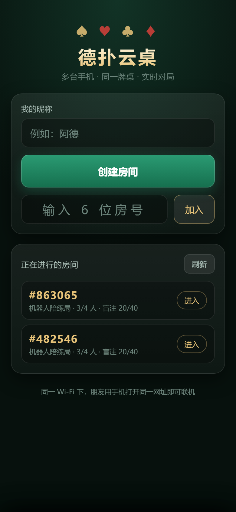
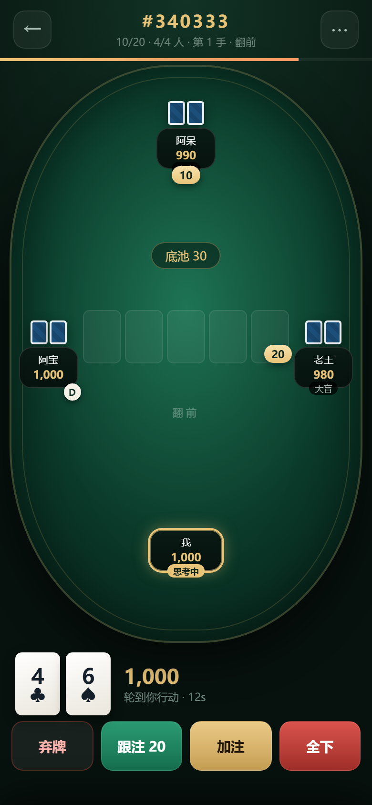
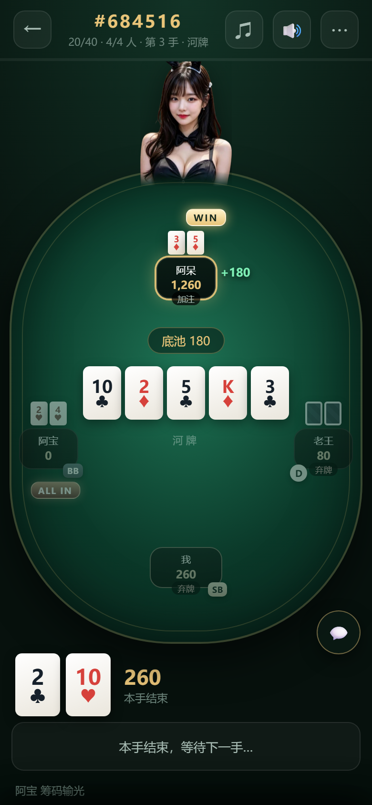
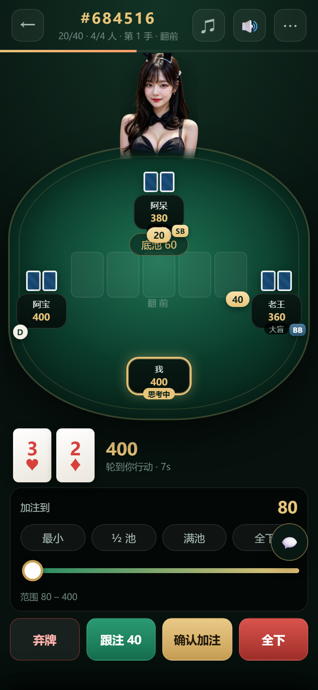
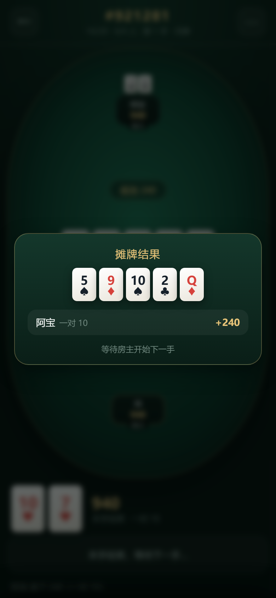
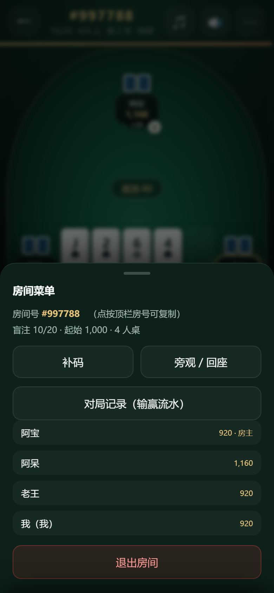
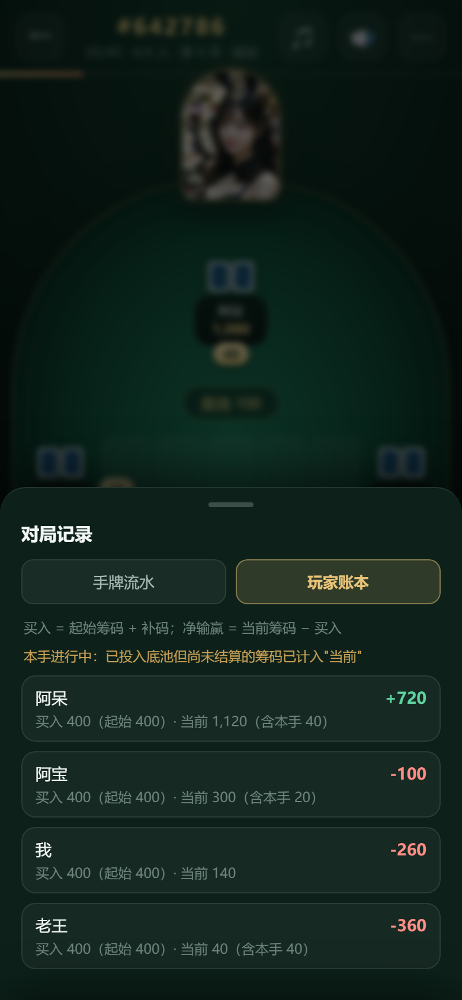
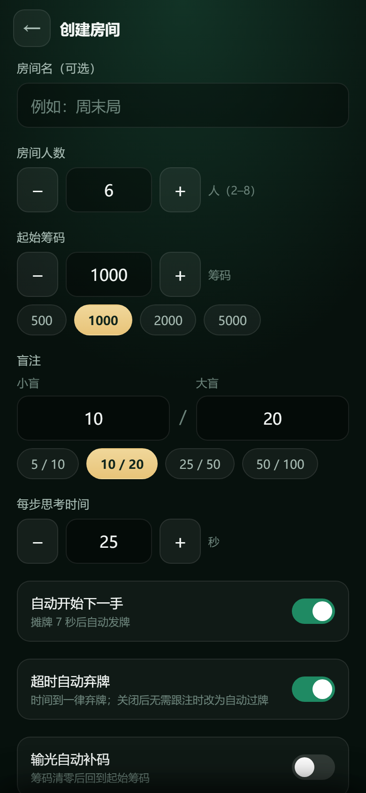

# 德扑云桌 · 手机多人德州扑克

手机浏览器打开就能玩的多人在线德州扑克：**一个人创建房间 → 设置人数 / 起始筹码 / 大小盲 → 把 6 位房号发给朋友 → 大家用各自手机进同一张牌桌**。

整套牌局由服务端统一裁决（洗牌、发牌、下注校验、边池、摊牌），每台手机只收到"自己能看的那一份"，所以开黑不会看到别人的底牌。



| 牌桌 | 全下（ALL IN + 火苗） |
| --- | --- |
|  |  |
| **加注面板** | **摊牌结算（含输家）** |
|  |  |
| **房间菜单** | **房间聊天** |
|  |  |
| **对局记录（手牌流水）** | **对局记录（玩家账本）** |
|  |  |
| **创建房间** |  |
|  |  |

---

## 1. 快速开始

需要 Node.js 20 以上（零第三方依赖，不用 `npm install`）。

```bash
cd coco_dezhou
npm start
```

启动后终端会打印地址：

```
  ♠ ♥ 德扑云桌 ♦ ♣  已启动  v1.0.0
  ├─ 本机：   http://localhost:18080
  ├─ 手机：   http://192.168.10.196:18080   （同一 Wi-Fi）
  └─ 数据目录：D:\deepseek\coco_dezhou\data
```

1. 手机连**同一个 Wi-Fi**，浏览器打开上面那个「手机」地址；
2. 输入昵称 → **创建房间** → 选人数、起始筹码、盲注；
3. 把顶栏的 **#房号** 发给朋友，他们在大厅输房号（或直接打开 `http://<你的IP>:18080/?room=房号`）即可入座；
4. 房主点「开始牌局」。

> 端口默认 18080，可用 `PORT=9000 npm start`（Windows PowerShell：`$env:PORT=9000; npm start`）修改；端口被占用时会自动往后找空闲端口。

### 只有一台手机也能试

另开一个终端跑机器人陪练，它会打印房号，其余机器人自动入座：

```bash
npm run bots
# 房号：522605
# 在手机上打开：http://127.0.0.1:18080/?room=522605
```

再按提示在手机浏览器打开 `http://<你的IP>:18080/?room=522605`，机器人房主会自动开局。

### 想让外地朋友也能玩（免费上线）

不在同一个 Wi-Fi 时，把服务放到公网，两条免费路线（详见 [docs/部署.md](docs/部署.md)）：

| 路线 | 一条命令/一次操作 | 特点 |
| --- | --- | --- |
| **Render 免费 Web Service** | 仓库推到 GitHub → Render 「Blueprint」→ 自动读 [render.yaml](render.yaml) | 有固定 https 域名；15 分钟无流量休眠，冷启动约 30–60 秒 |
| **Hugging Face Spaces** | `npm run hf` → 把 `dist/hf-space` 拖进新建的 Docker Space | 不用 Git 不用信用卡；约 48 小时无人访问才休眠 |

两者都支持 WebSocket、都是 https（前端会自动用 `wss://`）、都**没有持久磁盘**（牌局在内存里，休眠后旧房号失效，重新开房即可）。
不想自己部署，也可以先用内网穿透：`cloudflared tunnel --url http://localhost:18080`。

---

## 2. 功能

**房间**
- 创建时可选：人数上限 2–8、起始筹码、小盲/大盲、每步思考时间、是否自动开下一手、输光是否自动补码
- 6 位数字房号，支持大厅列表点选进入、输房号进入、带房号的分享链接进入
- 房主可开局 / 立即开下一手 / 移出玩家；房主离开自动移交给下一位在线玩家
- 断线自动重连并回到原座位（token 续局）；长时间掉线自动释放座位

**牌局**
- 完整流程：庄家与盲注轮转（单挑时庄家是小盲且翻前先行动）、翻前/翻牌/转牌/河牌
- 行动：弃牌、过牌、跟注、加注（滑杆 + 最小/½池/满池/全下快捷键）、全下
- 规则细节：最小加注额校验、短码全下不重开加注、单挑/多人盲注位置、只跟到全下额
- 结算：主池 + 多层边池、平分底池、奇数筹码按庄家后顺序分配、A2345 顺子、7 选 5 最佳牌型与中文牌型名
- 房间设置新增「**超时自动弃牌**」开关（默认开）：时间到一律弃牌；关闭后"无需跟注时自动过牌"。**连续 3 次超时自动旁观**，不再占着座位让别人干等
- 每步倒计时进度条，超时自动行动
- 摊牌自动亮牌并弹出结算；本手未参与的人等下一手
- **房间聊天**：牌桌右下角的 💬 打开聊天面板，边打牌边说话；有未读时按钮上出现红色角标；面板里能看到**完整聊天记录**（含谁进出了房间，保留最近 200 条），历史记录也能通过 `GET /api/rooms/:code/chat` 取到
- **背景音乐与音效**：全部用 WebAudio 现场合成，不加载音频文件。音乐有 **3 段可切换的爵士**（爵士酒廊 / 蓝调酒吧 / 巴萨诺瓦，点顶栏 **♫** 选曲或关闭），音效用 **🔊** 开关：发牌、筹码、过牌、弃牌、加注、全下、赢/输、轮到你、新消息
- **桌面动画**：桌沿上方有位荷官（图片可换成自己的），开牌时**一张一张**慢发底牌、公共牌从荷官飞向桌面；跟注/加注的筹码**先堆在自己面前**，一轮结束再一起收进底池；**全下的人亮起「ALL IN」徽章和跳动火苗**；摊牌时底牌翻面、底池筹码飞向赢家，结算面板还会列出**本手每个输家扣了多少**
  （系统开启「减少动态效果」时自动只保留静态效果）
- **对局记录**（房间 ⋯ 菜单 → 对局记录）：每手流水（公共牌、赢家、牌型、底池）可展开看每个人本手的 `剩余 → 剩余（输赢）`；「玩家账本」页显示每人的 **买入（起始筹码 + 补码）/ 当前筹码 / 净输赢**，点开可看逐手输赢明细
- 本地实时牌力提示（"两对 K"）

**数据**
- 房间表 `data/rooms.json`：房号、房名、人数、起始筹码、盲注、状态、局数、房主、更新时间
- 战绩表 `data/hands.jsonl`：每手一行（房号、局号、时间、公共牌、底池、赢家与金额）

---

## 3. 目录结构

```
coco_dezhou/
├─ server/
│  ├─ index.mjs      静态页面 + WebSocket + REST 接口
│  ├─ ws.mjs         零依赖 WebSocket 服务端（RFC6455 子集）
│  ├─ rooms.mjs      房间/成员/广播/行动计时/下一手自动开始
│  ├─ table.mjs      权威牌桌引擎（发牌、下注、边池、摊牌）
│  └─ store.mjs      房间表 + 战绩表落库（可替换为云数据表）
├─ shared/cards.mjs  牌型引擎（服务端裁决与手机端提示共用）
├─ web/              手机端 H5（原生 ESM，无需打包）
│  ├─ index.html  css/style.css  js/app.js  js/net.js
├─ tools/
│  ├─ bots.mjs       机器人陪练（一个人也能开局）
│  ├─ shot.mjs       无头 Edge 截图（开发自检）
│  ├─ live-check.mjs 上线自检（健康检查 + REST 建房 + wss 进房）
│  └─ make-hf-space.mjs  打包成 Hugging Face Space 目录
├─ Dockerfile / docker-compose.yml / render.yaml  一键部署
├─ tests/            牌型、引擎、端到端对局测试
└─ docs/
   ├─ CoCo接入方案.md  ← 与 CoCo 云房间 / 云数据表 的对接方式
   ├─ 协议.md          ← WebSocket 与 REST 接口说明
   ├─ 规则.md          ← 规则与状态机
   ├─ 部署.md          ← 内网穿透 / PaaS / 云服务器怎么上线
   └─ 二次开发.md      ← 想改文案 / 配色 / 数值 / 规则时改哪个文件
```

---

## 4. 与 CoCo 云房间 / 云数据表的关系

CoCo 的「云房间」是**作品内部**的广播通道，「云数据表」是**账号下**的表格，两者都只能通过 CoCo 编辑器里的积木/控件访问，网页或自建服务器无法直接读写它们。因此本项目把这两块能力抽象成清晰的边界，并提供三条落地路线：

| 路线 | 做法 | 适合 |
| --- | --- | --- |
| A. H5 + 本服务（**已开箱可用**） | 手机浏览器或 CoCo「网页框」加载本项目页面，联机由服务端负责；云数据表按本文档的字段保存房间表/战绩表 | 想立刻玩、要真联机 |
| B. CoCo 作品 + 本服务 REST | CoCo 里用「HTTP客户端」积木调用下面的 REST 接口（列表/创建/加入/轮询/行动），云房间只做"催场/喊话"通知，云数据表存房间表与战绩表 | 想把牌桌做成 CoCo 作品 |
| C. 纯 CoCo 积木 / 自定义控件 | 在 CoCo 侧自建裁判逻辑 | 需要较强积木功底，见文档中的限制说明 |

接口映射、云数据表建表字段、积木接线步骤、以及"为什么底牌不能直接走云房间广播"都在 **[docs/CoCo接入方案.md](docs/CoCo接入方案.md)** 里写清楚了。

REST 一览（供积木直接调用，均支持跨域）：

```
GET  /api/rooms                     房间列表
POST /api/rooms                     创建房间 {nickname,name,settings}
GET  /api/rooms/:code/view          旁观视图（不含底牌）
POST /api/rooms/:code/join          加入 {nickname,token?} → {token,playerId,seat}
GET  /api/rooms/:code/state         取状态（长轮询 20s，?token=&since=&wait=）
POST /api/rooms/:code/action        行动 {token,action:{type,to}}
POST /api/rooms/:code/start|chat|rebuy|sitout|kick|leave
GET  /api/rooms/rows                房间表内容（等价「查询云数据表」）
GET  /api/hands?n=30                战绩表最近 N 行
```

---

## 5. 测试

```bash
npm test          # 牌型 + 引擎 + 端到端
```

- `tests/poker.test.mjs`：牌型分类、A2345、踢脚、7 选 5
- `tests/table.test.mjs`：盲注位置、最小加注、弃牌收池、三人全下边池、超时、中途加入、离桌
- `tests/e2e.test.mjs`：真的起服务 + 3 个 WebSocket 客户端开桌，验证房号加入、底牌隐私、越权行动被拒、打满四街摊牌、筹码守恒、断线重连、房间表/战绩表落库、REST 接口

---

## 6. 设计要点

- **权威服务端**：洗牌用 `crypto` 随机源，牌只存在服务端；给每个玩家单独投影 `table.view(pid)`，别人的底牌字段为 `null`，摊牌时才公开。
- **零依赖 WebSocket**：`server/ws.mjs` 自己实现握手、帧解析、分片、ping/pong，所以整个项目不用 `npm install`，拷到任何有 Node 的机器就能跑。
- **计时器由服务端驱动**：每次状态变化重排一个定时器（行动超时 / 摊牌后自动开下一手），客户端只用 `deadline` 做倒计时显示，避免各端时钟不一致。
- **筹码守恒**：边池按每个玩家本手投入额分层计算，主池/边池分别比较牌力；平局余数按庄家后顺序分配。测试里对每一手都断言筹码总量不变。
- **断线续局**：加入时发一个随机 token，重连时带 token 即可回到原座位；页面刷新也会自动回到房间。

---

## 7. 常见问题

**手机打不开？**
- 手机和电脑要在同一个 Wi-Fi（不要用手机流量）；
- Windows 首次启动会弹防火墙提示，选「允许访问」；
- 确认电脑 IP 是 `192.168.x.x` / `10.x.x.x` 这种局域网地址（启动日志会打印）；
- 部分路由器开了「AP 隔离」，会禁止设备互访，可在路由器后台关掉。

**想公网联机？**
把服务跑在有公网 IP 的机器（或内网穿透工具）上，用 Nginx/Caddy 反代到 18080。页面会自动根据 `https` 使用 `wss://`，无需改代码。

具体做法（内网穿透 / Render / 云服务器 / 为什么 Aternos、函数计算不行）见 **[docs/部署.md](docs/部署.md)**；项目已带 [Dockerfile](Dockerfile) 可一键部署。

**数据会丢吗？**
房间是内存态（重启即消失），战绩写入 `data/hands.jsonl` 长期保留；`data/rooms.json` 是房间表的当前快照。

**房号会重复吗？**
房号在存活房间内唯一（6 位数字，随机分配），房间空了/30 分钟无人会自动回收。

---

## 8. 许可

仅用于学习与朋友间娱乐。请遵守所在地区法律法规，不要用于任何形式的赌博。
